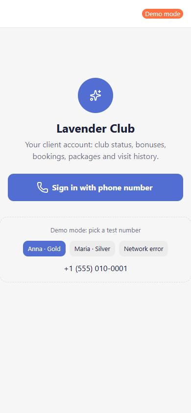
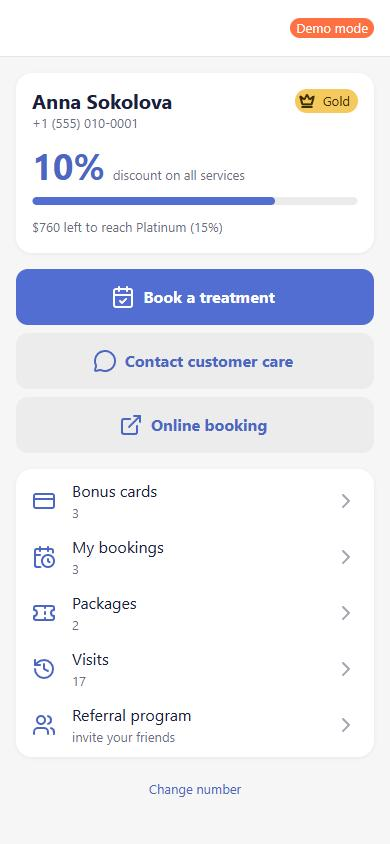
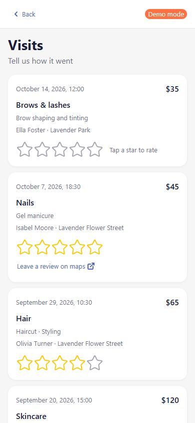
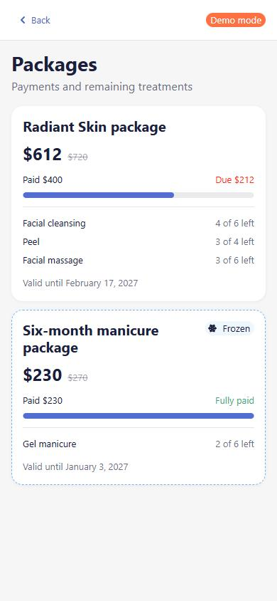
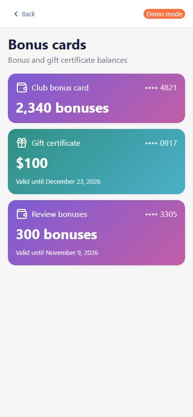
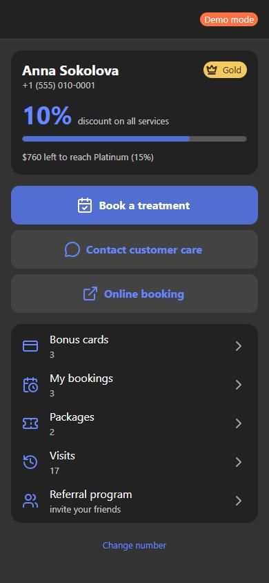

# Beauty Salon Client Account — Telegram Mini App

A portfolio demo: a client account for a chain of beauty salons. Clients see their club status, bonus cards, bookings, treatment packages, visit history with ratings, and the referral program.

One codebase runs in two environments:

- **Telegram Mini App** — via the official `telegram-web-app.js`;
- **regular browser** — a demo mode with test phone numbers, handy for showing the app without a messenger.

All data is mocked. Names, phone numbers, addresses and amounts are fictional.

## Screenshots

| Sign in | Home | Visits |
| --- | --- | --- |
|  |  |  |

| Packages | Bonus cards | Dark theme |
| --- | --- | --- |
|  |  |  |

> Images go into `docs/screenshots/` under these names.

## Features

- **Phone sign-in** via the messenger's native contact request (`requestContact`).
- **Home**: club level, progress to the next level, discount percentage, name and phone. "Book a treatment" and "Contact customer care" open a chat with a prefilled message; "Online booking" opens an external link.
- **Bonus cards**: bonus and gift certificate balances with expiry dates.
- **My bookings**: upcoming visits with date and time, category, branch and specialist.
- **Packages**: full and discounted price, paid and due amounts, payment progress, included treatments and how many are left, a "Frozen" badge.
- **Visits**: 5 at a time with "Show more", a 1–5 star rating per visit. A 5-star rating reveals a "Leave a review on maps" link for that branch.
- **Referral program**: terms plus "friends invited" and "bonuses earned" counters.
- **States**: loading skeletons, empty states, and an error state with a "Retry" button.
- **Theming**: light and dark themes from the messenger's theme params; in a browser, from `prefers-color-scheme`.
- **Native Back button** of the messenger on nested screens.
- Mobile-first layout, 360–430 px wide with no horizontal scroll.

## Tech stack

| | |
| --- | --- |
| Framework | Angular 22 — standalone components, signals, `OnPush`, lazy routes |
| UI kit | Taiga UI 4 (`@taiga-ui/core`, `kit`, `layout`, `icons`) |
| Language | TypeScript strict, SCSS |
| Linting | angular-eslint (including template accessibility rules) |
| Server demo | Node.js 22 + TypeScript, `node:http`, tests with `node:test` |
| CI/CD | GitHub Actions → GitHub Pages |

## Project structure

```
src/app/
├─ platform/            messenger adapter
│  ├─ messenger-platform.ts   MessengerPlatform interface + InjectionToken
│  ├─ telegram.platform.ts    Telegram.WebApp
│  ├─ browser-demo.platform.ts demo mode outside the messenger
│  └─ platform.factory.ts     detection at startup
├─ api/                 contract and mock of POST /api/client/profile
│  ├─ profile.types.ts
│  ├─ profile.mocks.ts
│  └─ profile-api.service.ts
├─ core/                session state, theme, Back button, guards, salon contacts
├─ shared/              skeletons, empty state, error state, page header, pipes
└─ pages/               login, home, cards, bookings, subscriptions, visits, referral
server/                 Telegram initData validation (not deployed)
```

## Platform adapter architecture

Components never touch `window.Telegram` directly. They get a `MessengerPlatform` through DI:

```ts
export interface MessengerPlatform {
  ready(): void;
  expand(): void;
  getTheme(): PlatformTheme;
  onThemeChange(cb: (theme: PlatformTheme) => void): () => void;
  requestPhone(): Promise<string | null>;
  openChat(username: string, text: string): void;
  openLink(url: string): void;
  showBackButton(cb: () => void): void;
  hideBackButton(): void;
  haptic(type?: 'light' | 'success' | 'error'): void;
}
```

**Detection** (`platform.factory.ts`). The Telegram SDK is loaded in `index.html` and creates `window.Telegram.WebApp` even in a regular browser, so a non-empty `initData` is what signals the app is running inside Telegram. If it is present, `TelegramPlatform` is used; otherwise `BrowserDemoPlatform`.

**How the adapter is used:**

- `ThemeService` reads `getTheme()` and subscribes to theme changes. It sets `tuiTheme="dark|light"` on `tui-root` and maps the messenger's theme params (`bg_color`, `button_color`, `hint_color`…) to Taiga UI CSS variables, so the app looks native in any Telegram theme.
- `BackButtonService` listens to the router and shows the native Back button on nested screens. A browser has no such button, so `BrowserDemoPlatform` exposes the handler through a signal and the app renders its own.
- A new platform (for example, another messenger) can be added as one class, without touching the components.

**Data.** `ProfileApiService.getProfile(phone)` returns `Promise<ClientProfileResponse>` after a 400 ms delay. The types in `profile.types.ts` describe the `POST /api/client/profile` contract: `client`, `cards[]`, `visits[]` (the 20 latest appointments, upcoming and past), `subscriptions[]`, `reviewLinks`. To switch to a real backend, replace the method body with `HttpClient.post`; components and types stay the same. Loading state lives in a signal-based `SessionStore` that is protected against races on repeated requests.

## Why phone sign-in is verified on the server

Anything coming from a WebView can be forged by the client. The phone number returned by `requestContact` in the browser is just a JavaScript string. If the backend served a profile for `POST /api/client/profile { phone }` without verification, anyone could open DevTools, substitute someone else's number and see their bookings, packages and bonuses.

The correct flow for Telegram:

1. The mini app sends `Telegram.WebApp.initData` to the server. This string is signed by Telegram with a key derived from the bot token.
2. The server verifies the HMAC signature (`server/src/validate-init-data.ts`) and the freshness of `auth_date`. Only then does it trust `user.id`.
3. The server takes the phone number not from the request but from the contact Telegram sent to the **bot** after `requestContact` (an update with `message.contact`, where `contact.user_id` matches the sender). The server stores the `telegram user id → phone` mapping.
4. The server queries yclients/amoCRM by that phone and returns the profile.

`BOT_TOKEN` lives only on the server, in an environment variable. It is not, and must not be, in the frontend. Validation follows the [official algorithm](https://core.telegram.org/bots/webapps#validating-data-received-via-the-mini-app):

```
secret_key        = HMAC_SHA256(key = "WebAppData", data = bot_token)
data_check_string = all fields except hash, sorted by key, "key=value" joined with \n
valid             = hex(HMAC_SHA256(key = secret_key, data = data_check_string)) == hash
```

The signature is compared in constant time (`timingSafeEqual`). An `auth_date` in the future is rejected (60 s clock skew allowed). The endpoint does not reveal the rejection reason to the client. Tests cover a valid signature, tampered data, an injected field, another bot's token, expired and future `auth_date`, and a missing `hash`.

## Frontend security

- **CSP.** GitHub Pages cannot set HTTP headers, so the production build uses Angular's `autoCsp`. `index.html` gets a `<meta>` policy with `script-src 'strict-dynamic'` plus SHA-256 hashes, `object-src 'none'` and `base-uri 'self'`.
- **External links.** `openLink` only opens `https:` URLs: review links come from the API, so `javascript:`/`data:` are rejected. In a browser, links open with `noopener,noreferrer`.
- **Chats.** The username is checked against Telegram's format. The prefilled text is encoded with `encodeURIComponent` and does not include the client's phone: it goes into a `t.me` URL, and the salon already sees the sender's account.
- **Templates.** No `innerHTML` or `bypassSecurityTrust*`: all output goes through Angular interpolation with automatic escaping.
- **Secrets.** There are none in the frontend. `BOT_TOKEN` is read only from an environment variable on the server, and `.env*` files are git-ignored.
- **Dependencies.** `npm audit` reports 0 vulnerabilities. A vulnerable `minimatch` pulled in by `ng-morph` (a Taiga UI dev tool) is pinned to a fixed version via `overrides`.
- **CI.** The workflow defaults to `contents: read`. Only the `deploy` job gets `pages: write` and `id-token: write`. `checkout` does not persist the token, and the repository name reaches the shell through `env` rather than direct expression interpolation.
- **Phone number.** Stored only in the current tab's `sessionStorage` to survive a reload, and cleared on "Change number".

## Running locally

Requires Node.js 22+.

```bash
npm install
npm start
```

Open http://localhost:4200. Outside a messenger the app runs in demo mode. The sign-in screen lets you pick a test number:

- **Anna · Gold** — full profile: bookings, two packages (one frozen), 17 visits;
- **Maria · Silver** — empty "My bookings" and "Packages";
- **Network error** — the first request fails (error screen), "Retry" loads the profile.

Other commands:

```bash
npm run build      # production build into dist/beauty-club/browser
npx ng lint        # ESLint + template accessibility rules

cd server
npm install
npm test           # validateTelegramInitData unit tests
BOT_TOKEN=<token> npm start   # demo endpoint POST /api/client/profile on :3000
```

## Opening it in Telegram

1. Create a bot in [@BotFather](https://t.me/BotFather): `/newbot`.
2. Deploy the app to GitHub Pages (see below) — Telegram only opens HTTPS URLs.
3. In @BotFather: `/mybots` → your bot → **Bot Settings → Configure Mini App → Enable Mini App**, and set the URL, e.g. `https://<user>.github.io/<repo>/`. Alternatively, set up a menu button: **Bot Settings → Menu Button**.
4. Open the bot and tap the mini app button. The app sees a non-empty `initData` and switches to `TelegramPlatform`. The Back button, theme and contact request become native.
5. Replace the `bookingUsername`, `careUsername` and `onlineBookingUrl` placeholders in `src/app/core/salon.config.ts` with real values.

> There is no backend on GitHub Pages, so after `requestContact` the profile still comes from the mocks. To see a profile in Telegram, the number must match one of the test numbers (`+1 555 010-0001`, `+1 555 010-0002`). Otherwise you get a "client not found" message — which is part of the demo too.

## Deploying to GitHub Pages

The `.github/workflows/deploy.yml` workflow runs on every push to `main`:

1. `npm ci` → `ng lint` → `ng build --base-href /<repo-name>/` (`/` for a `<user>.github.io` repository);
2. copies `index.html` to `404.html` so deep links to nested screens open the app;
3. in parallel, runs typecheck and tests for `server/`;
4. publishes `dist/beauty-club/browser` with `actions/deploy-pages`.

In the repository settings: **Settings → Pages → Build and deployment → Source: GitHub Actions**.

## Limitations

**Mocked:**

- the entire backend: `ProfileApiService` serves data from `profile.mocks.ts`; there are no real requests to yclients/amoCRM;
- visit ratings live only in page memory;
- salon contacts (`salon.config.ts`) are placeholders, and map links are searches for a fictional name;
- `server/` demonstrates signature verification only. It is not connected to the frontend, does not store the user id → phone mapping, and is not deployed.

**Telegram:** prefilling text via `t.me/<username>?text=…` depends on the Telegram client version. Older clients open the chat without the text.
